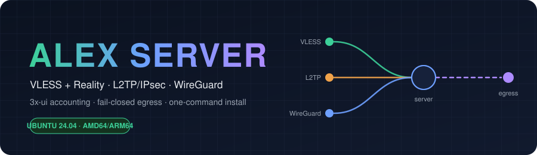
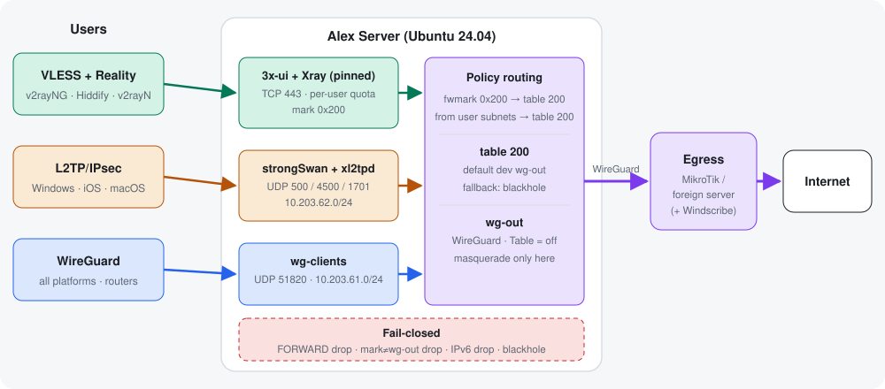

<div align="center">



<br><br>

<a href="./docs/SETUP.md"></a>
<a href="./docs/architecture.html"></a>
<a href="./docs/LESSONS.md"></a>

<br>

<sub><strong>ALEX SERVER</strong> · VLESS + Reality · L2TP/IPsec · WireGuard · fail-closed egress</sub>

</div>

---

<div dir="rtl">

## این پروژه چیست؟

یک اسکریپت نصب برای راه‌اندازی یک سرور VPN روی **Ubuntu 24.04**. سه روش اتصال برای کاربران دارد و همهٔ ترافیک کاربران **فقط** از یک تونل WireGuard به یک سرور یا روتر خارجی (مثلاً میکروتیک + Windscribe) خارج می‌شود:

| روش اتصال | برای چه کسی | مدیریت |
|---|---|---|
| **VLESS + Reality** | گوشی و کامپیوتر (v2rayNG، Hiddify، v2rayN) | پنل وب **3x-ui**: سقف حجم، تاریخ انقضا، لینک سابسکریپشن و آمار مصرف هر کاربر |
| **L2TP/IPsec** | ویندوز، iOS و مک (بدون نصب اپ) | دستور `l2tp-user` |
| **WireGuard** | همهٔ سیستم‌عامل‌ها و روترها | دستور `wg-user` همراه با QR |

<div align="center"></div>

### چرا fail-closed؟
اگر تونل خروجی قطع شود، کاربران **اینترنت ندارند.** هیچ ترافیکی از IP خود سرور بیرون نمی‌رود. این را چهار لایه تضمین می‌کنند: route نوع blackhole، قاعدهٔ kill switch در nftables، `FORWARD drop` و drop کامل IPv6 کاربران.

## نصب سریع (۵ قدم)

```bash
# 1) on a fresh Ubuntu 24.04 server, as root
apt-get update && apt-get install -y git
git clone https://github.com/Rezaloder/Alex-Server.git && cd Alex-Server

# 2) configure
cp .env.example .env && nano .env

# 3) install (prints THIS server's egress public key)
sudo ./install.sh

# 4) put that key on your egress router, fill EGRESS_PEER_PUBKEY in .env, then
sudo ./install.sh

# 5) check
sudo alex-status
```

راهنمای کامل، شامل تنظیم میکروتیک و Windscribe، ساخت کاربر، تنظیم کلاینت‌ها، جابه‌جایی سرور و عیب‌یابی، در **[docs/SETUP.md](./docs/SETUP.md)** است.

## مدیریت روزانه

```bash
sudo l2tp-user add ali 'StrongPass1'    # L2TP user
sudo wg-user add sara                    # WireGuard user + QR code
sudo alex-status                         # health + leak check
sudo ./backup.sh                         # full backup for migration
```
کاربران VLESS از داخل **پنل وب** ساخته می‌شوند.

## ساختار repo

| مسیر | کار |
|---|---|
| `install.sh` | نصب و تنظیم کامل. چند بار اجرا کردنش امن است |
| `.env.example` | همهٔ تنظیمات در یک فایل |
| `backup.sh` / `restore.sh` | جابه‌جایی به سرور جدید بدون نیاز به کانفیگ جدید برای کاربران |
| `tools/` | `l2tp-user`، `wg-user`، `alex-status`، `alex-routing` |
| `docs/` | راهنمای نصب، معماری و درس‌هایی که از راه‌اندازی واقعی گرفته شد |

## نکته‌های امنیتی
- فایل `.env` و بک‌آپ‌ها رمز و کلید دارند. **هرگز commit نشوند** (`.env` در `.gitignore` است).
- بعد از نصب، **2FA پنل** را روشن کن و رمزها و PSK را قوی بگذار.
- هستهٔ Xray عمداً روی نسخهٔ پایدار قفل شده است. از داخل پنل آن را به نسخهٔ pre-release آپدیت نکن (توضیح در [LESSONS](./docs/LESSONS.md)).

## وضعیت
این اسکریپت از روی یک سرور واقعی ساخته شده که همین طراحی روی آن کار می‌کند و تست شده است. تک‌تک اجزا (routing، فایروال، L2TP، Reality و هستهٔ Xray) روی آن سرور تأیید شده‌اند. اجرای کامل `install.sh` روی یک سرور کاملاً خام هم باید یک بار انجام شود. اگر خطایی دیدی، خروجی را در Issues بگذار.

</div>
